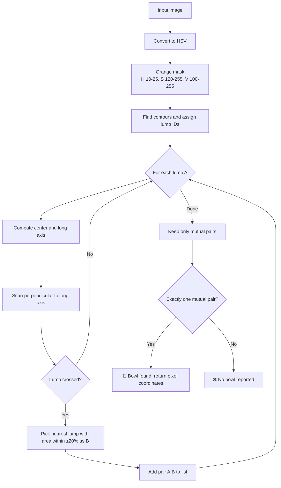

<div align="center">

# 🥣 translucent_bowl_detection

**A custom, classical computer-vision algorithm for detecting translucent bowls and boxes**


</div>

---

## 📖 Overview

This repository contains a custom algorithm to detect translucent bowls or boxes.
Instead of training a neural network, it relies on a simple geometric idea:
a translucent container shows up as **two orange lumps of similar size, facing each other** across the object.

---

## 💡 How It Works

1. Segment orange regions in HSV space.
2. Treat each connected region as a "lump".
3. For every lump, scan perpendicular to its long axis and look for a similarly sized partner.
4. Keep only **mutual** matches, so that A picks B and B picks A.
5. Report the bowl if exactly one mutual pair remains.

---

## 🧮 Algorithm

### Preprocessing

| Step | Action |
|:----:|--------|
| 1 | Convert the image to HSV. |
| 2 | Build a binary mask of orange pixels (`H 10-25`, `S 120-255`, `V 100-255`). |
| 3 | Find the contours in the mask and assign IDs `1..n` to the lumps. |
| 4 | Initialize an empty list of pairs. |

### Pair search

**5. For each lump `A`:**

| Sub-step | Action |
|:--------:|--------|
| 5.1 | Compute the center of `A` and the direction of its long axis. |
| 5.2 | Set the scan direction perpendicular to the long axis. |
| 5.3 | Scan from the center of `A` in both directions until the image border. |
| 5.4 | Collect every other lump crossed by the scan line, nearest first. |
| 5.5 | If no lump was crossed, continue with the next lump. |
| 5.6 | Select the nearest crossed lump whose area is within ±20% of the area of `A` as partner `B`. |
| 5.7 | Add the pair `(A, B)` to the list of pairs. |

### Verification and decision

| Step | Action |
|:----:|--------|
| 6 | Keep only mutual pairs, i.e. pairs `(A, B)` for which `(B, A)` is also in the list. |
| 7 | **If** exactly one mutual pair exists, report that the bowl exists and return its pixel coordinates. |
| 8 | **Else**, report that no bowl was found. |

---

## 🔀 Flowchart



---

## ⚙️ Parameters

| Parameter | Value | Description |
|-----------|-------|-------------|
| Hue (`H`) | 10-25 | Orange hue range |
| Saturation (`S`) | 120-255 | Minimum color intensity |
| Value (`V`) | 100-255 | Minimum brightness |
| Area tolerance | ±20% | Allowed size difference between partner lumps |

---

## 🚀 Usage

```bash
# Coming soon
python detect_bowl.py --image path/to/image.jpg
```

---

## 📄 License

Add your license here.
