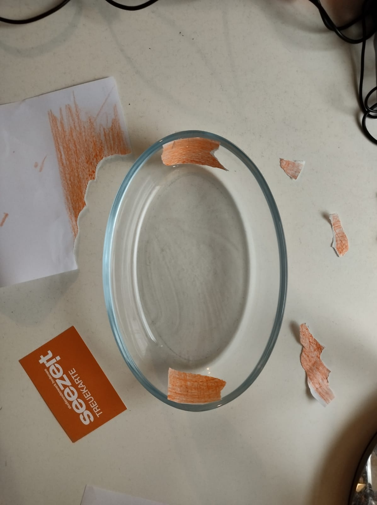
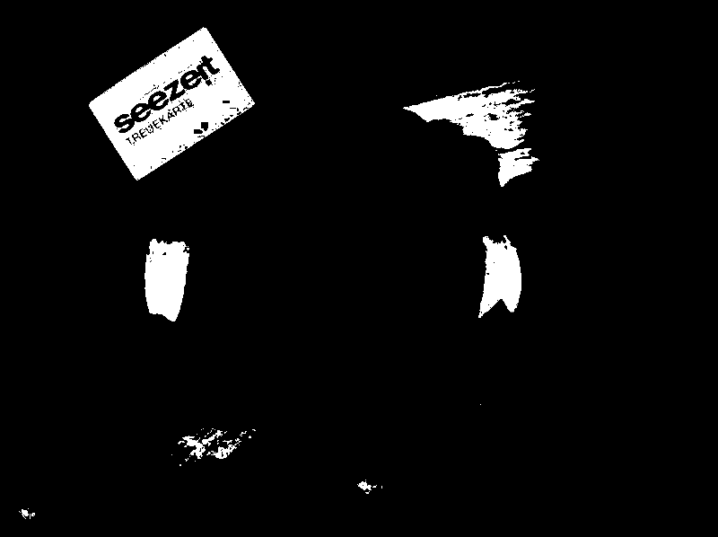
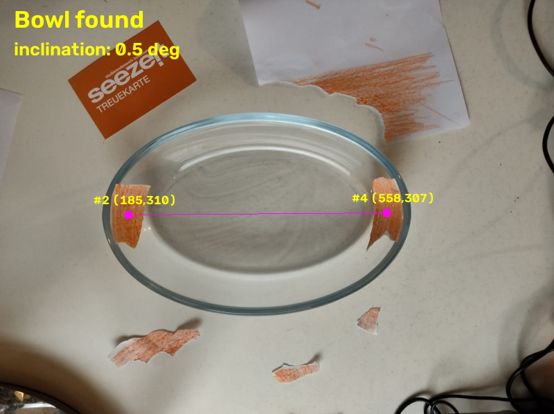
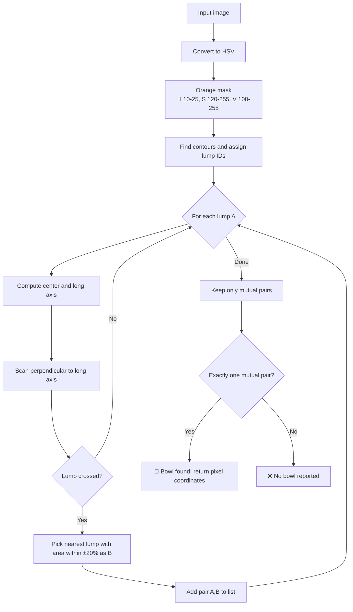

<div align="center">

# 🥣 translucent_bowl_detection

**A custom, classical computer-vision algorithm for detecting translucent bowls and boxes**


</div>

---

## 📖 Overview

This repository contains a custom algorithm to detect translucent bowls or boxes.
Instead of training a neural network, it relies on simple geometric data.

A translucent box is hard to segment directly, but its **handles** are easy to spot.
Looking at the box, the handles have three properties:

1. **Color:** the handles have a distinct color (orange or green or whatever).
2. **Perpendicular placement:** the handles lie across from each other, and the line connecting them is perpendicular to their long axes.
3. **Same shape and size:** both handles are of similar shape and size.

The algorithm makes use of these three properties.

---

## 💡 Detection results


<table align="center">
  <tr>
    <td align="center">
      <br>
      <b>Figure 1</b><br>Input image
    </td>
    <td align="center">
      <br>
      <b>Figure 2</b><br>Orange mask generation
    </td>
    <td align="center">
      <br>
      <b>Figure 3</b><br> Lump Id assignment
    </td>
    <td align="center">
      <br>
      <b>Figure 4</b><br>Perpendicular scan lines
    </td>
    <td align="center">
      <br>
      <b>Figure 5</b><br>Output image
    </td>
  </tr>
</table>

## 💡 How It Works

1. Segment orange regions in HSV space.
2. Treat each connected region as a "lump".
3. For every lump, scan perpendicular to its long axis and look for a similarly sized partner.
4. Keep only **mutual** matches, so that A picks B and B picks A.
5. Report the bowl if exactly one mutual pair remains.

---

## 🧮 Algorithm

### Preprocessing

| Step | Action |
|:----:|--------|
| 1 | Convert the image to HSV. |
| 2 | Build a binary mask of orange pixels (`H 10-25`, `S 120-255`, `V 100-255`). |
| 3 | Find the contours in the mask and assign IDs `1..n` to the lumps. |
| 4 | Initialize an empty list of pairs. |

### Pair search

**5. For each lump `A`:**

| Sub-step | Action |
|:--------:|--------|
| 5.1 | Compute the center of `A` and the direction of its long axis. |
| 5.2 | Set the scan direction perpendicular to the long axis. |
| 5.3 | Scan from the center of `A` in both directions until the image border. |
| 5.4 | Collect every other lump crossed by the scan line, nearest first. |
| 5.5 | If no lump was crossed, continue with the next lump. |
| 5.6 | Select the nearest crossed lump whose area is within ±20% of the area of `A` as partner `B`. |
| 5.7 | Add the pair `(A, B)` to the list of pairs. |

### Verification and decision

| Step | Action |
|:----:|--------|
| 6 | Keep only mutual pairs, i.e. pairs `(A, B)` for which `(B, A)` is also in the list. |
| 7 | **If** exactly one mutual pair exists, report that the bowl exists and return its pixel coordinates. |
| 8 | **Else**, report that no bowl was found. |

---

## 🔀 Flowchart



---

## ⚙️ Parameters

| Parameter | Value | Description |
|-----------|-------|-------------|
| Hue (`H`) | 10-25 | Orange hue range |
| Saturation (`S`) | 120-255 | Minimum color intensity |
| Value (`V`) | 100-255 | Minimum brightness |
| Area tolerance | ±20% | Allowed size difference between partner lumps |

---


## 📄 License

This project is licensed under the **Apache License 2.0**. See the [LICENSE](LICENSE) file for details.

```
Copyright 2026 <your name or organization>

Licensed under the Apache License, Version 2.0 (the "License");
you may not use this file except in compliance with the License.
You may obtain a copy of the License at

    http://www.apache.org/licenses/LICENSE-2.0

Unless required by applicable law or agreed to in writing, software
distributed under the License is distributed on an "AS IS" BASIS,
WITHOUT WARRANTIES OR CONDITIONS OF ANY KIND, either express or implied.
See the License for the specific language governing permissions and
limitations under the License.
```
